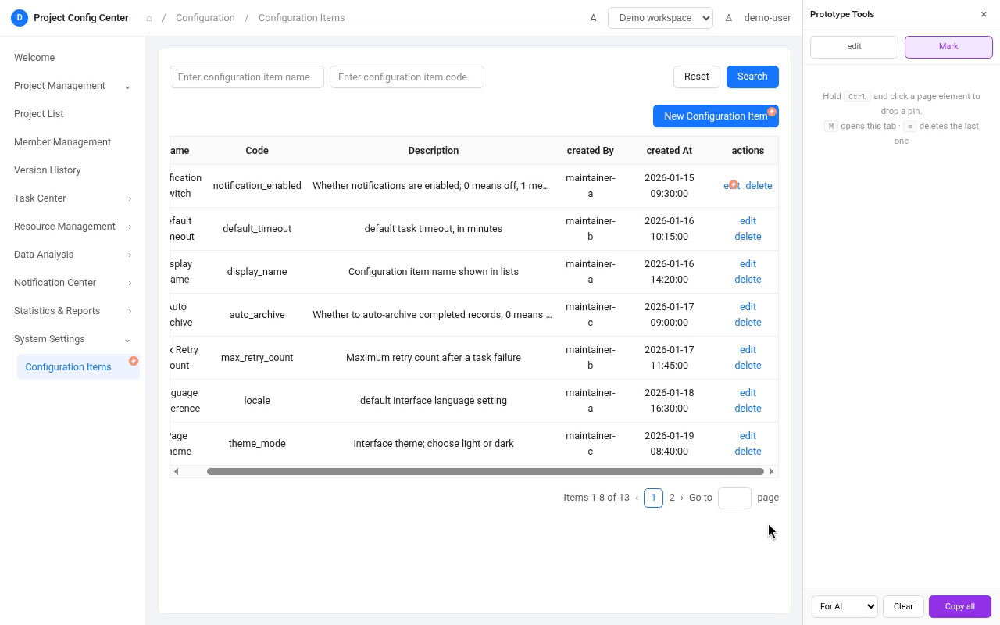
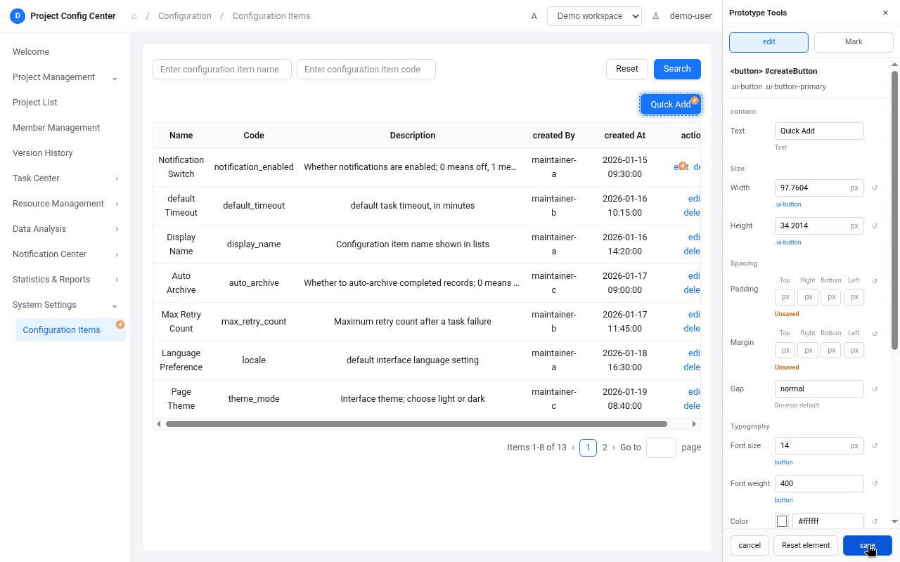
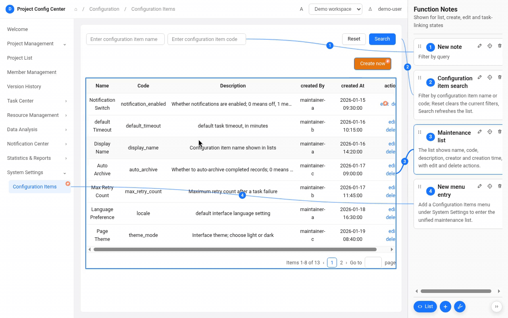
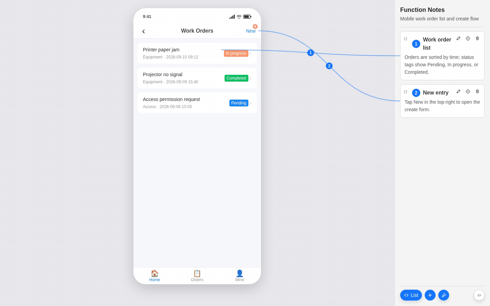

# AI HTML Annotation

[中文](README.zh-CN.md)

[](https://skills.sh/Lisuiwen/ai-html-annotation)

> Agent Skill for native HTML prototypes with real-DOM annotations — for Claude Code, Codex, Cursor, and other coding agents.

**The page is the deliverable, not just a picture of one.** Build from a UI pack, annotate on the live DOM, copy feedback to an AI, and ship clean multi-state screenshots.

Experimental 0.x · zero npm dependencies · MIT · [Changelog](CHANGELOG.md)

## Why it exists

Chat comments never hit an element, screenshot-based HTML drifts, and spec / chat / source stay disconnected. The [product guide](docs/guide.md) covers why that fails, four jobs on the loop, and the numbered workflow.

```text
generate HTML from a UI pack
        │
        ▼
     Viewer
        │
        ├── Mark → Copy for AI   (optional)
        ├── Direct Edit          (optional)
        ├── Inspector            (optional)
        └── Sketch board         (optional clipboard image)
        │
        ▼
   scenarios
```

Mark, Direct Edit, Inspector, and the sketch board are parallel options after Viewer, not a required sequence.

## See it first

Walkthrough video: [media/hero-main.mp4](media/hero-main.mp4) (GitHub may not autoplay — open the file).

### Review the page the way a PM would

Formal annotations sit on the real DOM. Add, edit, or browse them, switch page states, and follow SVG connectors to the matching modules — same page, not a separate spec.


### Pin a problem and copy it to the AI

Hold `Ctrl` (macOS: `⌘`) and click an element to drop a removable review pin. Then `Copy all → For AI` exports selectors plus element HTML.



### Tweak style or copy on the live page

Author Tools → **edit**. Hold `Ctrl` (macOS: `⌘`), change copy or styles (for example a background color), and save. The editor UI stays in the authoring session; it is not injected into the deliverable.



### Lock the thing that looks wrong and jump to source

Hold `Alt + Shift`, hover to see the selector, click to open that location in your local IDE.



### Sketch a rough layout and copy it to the AI

Author Tools → **sketch**. Drag components from an installed UI pack onto a free canvas — including the ECharts charts in `admin-desktop` and `mobile-vant` — draw a phone frame if you need one, and edit text on the selected piece. **Copy image** puts that canvas on the clipboard. It does not download a file, and it is not part of the delivered page.

### Deliver clean multi-state screenshots

Multi-state screenshots hide the annotation rail, connectors, and Author Tools. Formal HTML can still show Viewer; the PNGs are the product page only.



### Generate from a UI pack so pages stay visually consistent

Installable visual systems — tokens, components, patterns — not bundled inside the Skill. Official packs: `admin-desktop` (desktop admin) and `mobile-vant` (phone-width H5). Both include the same ECharts set (line, bar, donut, mixed, funnel, gauge, heatmap, and map), which you can place on the sketch board or generate into a page. Customize or author a pack with the `ui-pack-maintain` skill when the official simulation is the wrong visual language. Details: [UI packs](docs/ui-packs.md).

## Fit / not fit

**Fit** when you need to:

- turn UI materials into openable HTML quickly;
- review on the real page and copy precise feedback to an AI;
- iterate structure, copy, and state while keeping reproducible screenshots;
- keep admin, config, or interaction prototypes visually stable across tasks.

**Not a fit** as a production component library, a Figma replacement, a third-party design-system implementation, or a general frontend scaffold / production code generator.

## Install

skills.sh is the default. Then install a UI pack (`admin-desktop` for desktop, `mobile-vant` for phone) and open Author Tools — steps in [5-minute quickstart](docs/quickstart.md).

```bash
npx skills add https://github.com/Lisuiwen/ai-html-annotation --skill html-prototype-build
```

Open [`examples/minimal-notes-system/prototype.html`](examples/minimal-notes-system) (desktop sample in this repo).

Claude Code marketplace is secondary: `/plugin marketplace add Lisuiwen/ai-html-annotation` then `/plugin install ai-html-annotation@lisuiwen-agent-skills`. Pack authors also install `ui-pack-maintain`.

## Examples

- Default walkthrough: [`examples/minimal-notes-system`](examples/minimal-notes-system) (admin desktop).
- Alternate: [`examples/mobile-work-order`](examples/mobile-work-order) (mobile H5, `mobile-vant`).

## Where to go next

- [Product guide](docs/guide.md) — why it fails, four scenarios, capabilities, numbered steps
- [Quickstart](docs/quickstart.md) · [UI packs](docs/ui-packs.md) · [Comparison](docs/comparison.md) · [FAQ](docs/faq.md)
- [Docs index](docs/README.md)
- Skill overview → [html-prototype-build README](skills/html-prototype-build/README.md) ([中文](skills/html-prototype-build/README.zh-CN.md))

Skill references, UI pack contracts, and addon docs are in English.

## For agents

Local Author Tools, the sketch board, pack install, and screenshot commands: [Local authoring](skills/html-prototype-build/references/local-authoring.md), [Sketch board](skills/html-prototype-build/references/sketch-board.md), [Pack install](skills/html-prototype-build/references/pack-install.md), [Screenshots](skills/html-prototype-build/references/screenshots.md). Agent routing: [SKILL.md](skills/html-prototype-build/SKILL.md).

## Distribution layout

```text
.claude-plugin/marketplace.json  Claude Code marketplace catalog
.html-prototype/packs/           Official UI packs
skills/html-prototype-build/     Prototype build Agent Skill
skills/ui-pack-maintain/         UI pack authoring Agent Skill
examples/                        Runnable samples
media/                           README demo assets
docs/                            Product docs
```

## Security

- Author Tools bind to `127.0.0.1` only. Do not run authoring or screenshots against untrusted HTML.
- The author page has a Stop button that shuts that local server down immediately. Closing the last tab waits 3 minutes. With no requests for 2 hours, the process exits. Starting it again while the same page is already running reuses that process.
- Author writes require same-origin localhost JSON. Keep the Skill-root `.env` local for IDE selection; never commit it.
- Direct Edit, Mark, and the sketch board load only in the authoring session. Direct Edit writes style/copy through localhost; Mark stores pins in page-scoped `localStorage` and may copy to the clipboard. Sketch **Copy image** copies the canvas to the clipboard and does not write a file. None of them is injected into source HTML. The sketch board is served at `/sketch/` by the same author server.
- Do not put real credentials, production data, personal information, or unauthorized brand assets in prototypes.

## Contributing

Experimental 0.x; APIs and layout may change. See [`.github/CONTRIBUTING.md`](.github/CONTRIBUTING.md) and [`.github/CODE_OF_CONDUCT.md`](.github/CODE_OF_CONDUCT.md). Report vulnerabilities privately per [`.github/SECURITY.md`](.github/SECURITY.md).

UI packs are original native-HTML visual simulations. They do not bundle third-party design-system code; vendored libraries (Apache ECharts, stamped into both official packs from `.html-prototype/pack-plugins/echarts/`) ship inside the pack and are listed in [NOTICE](NOTICE). The chart plugin is not a third installable pack.

## License

[MIT](LICENSE). Third-party attribution is in [NOTICE](NOTICE) (html-mark credit and Apache ECharts).
